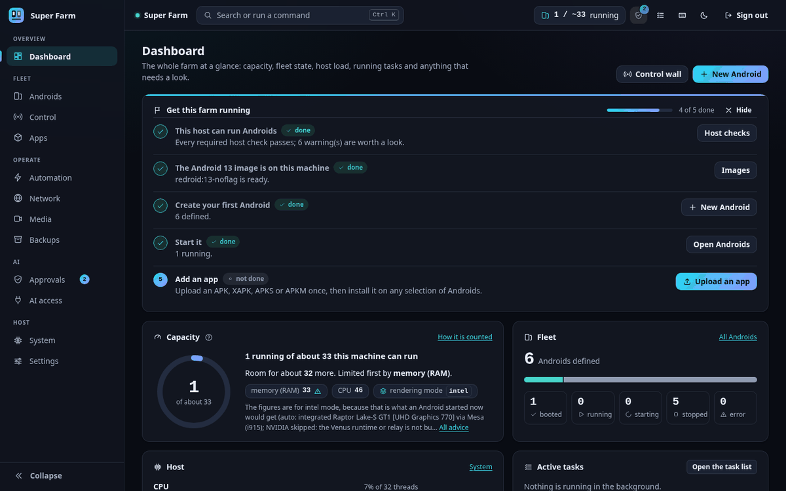
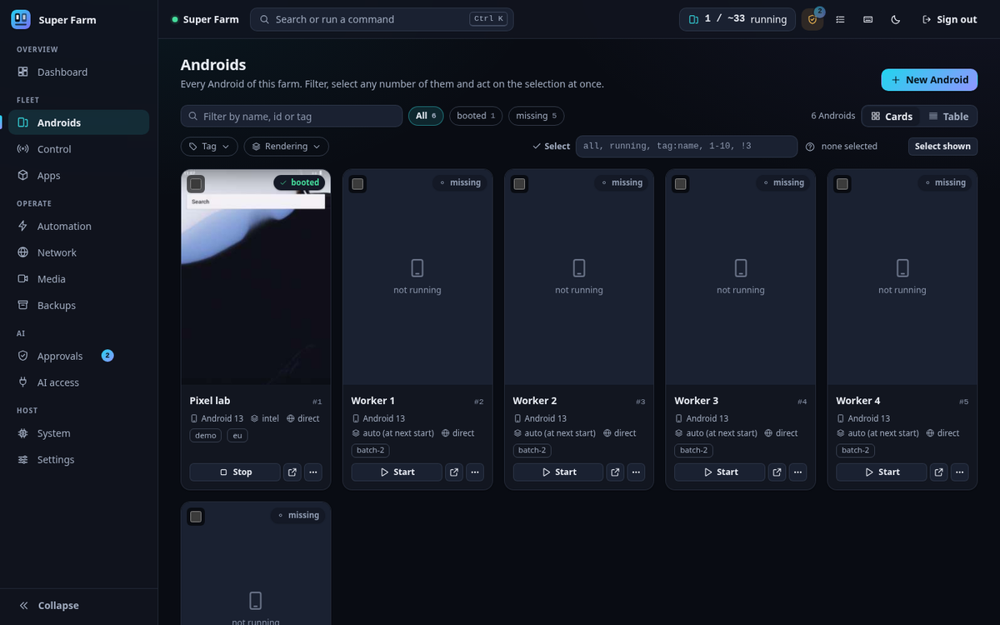
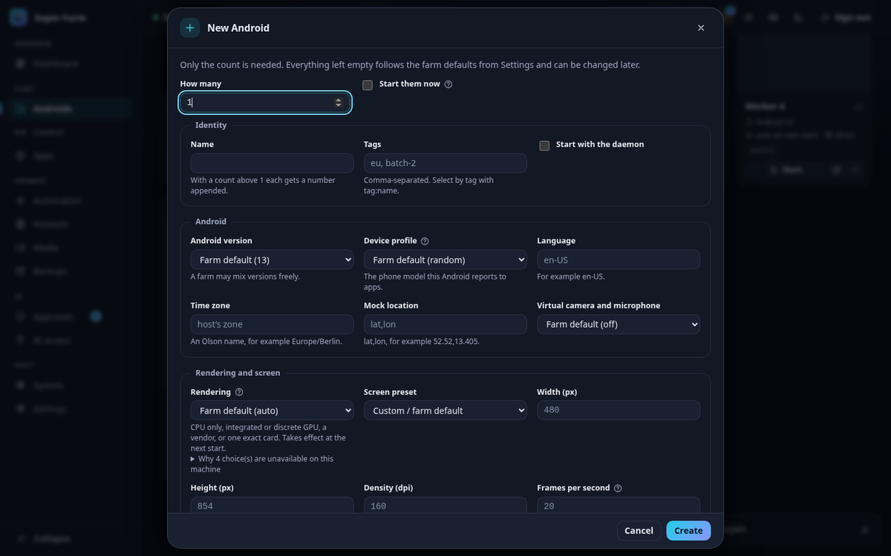
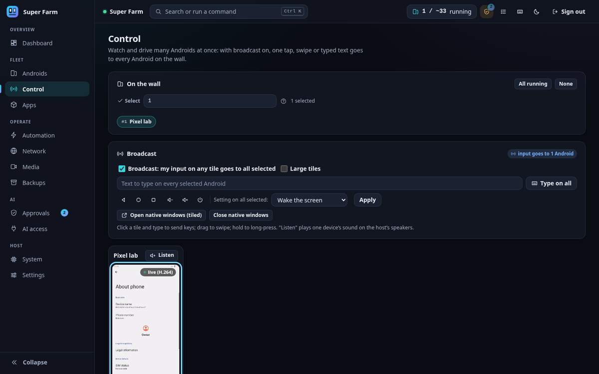
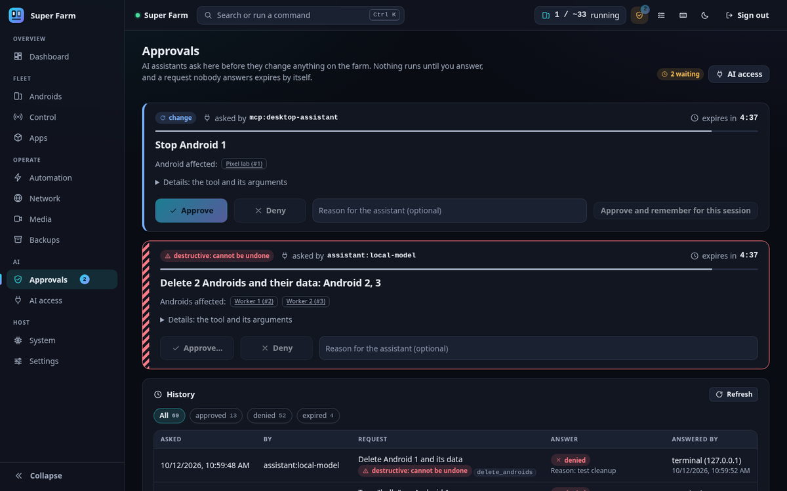
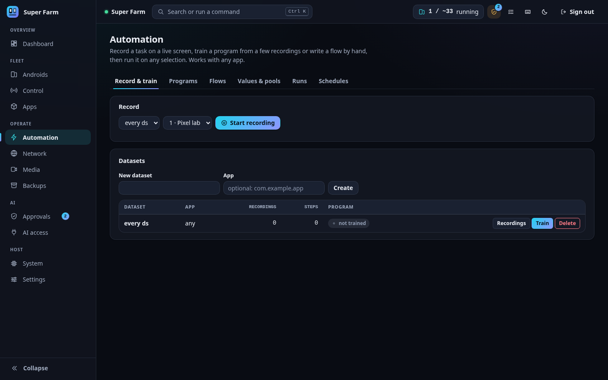

# Super Farm

Super Farm runs many Android instances as Docker containers on one Linux machine and controls them from a web panel, a command line (`sf`) and an HTTP API. Each Android has its own data volume, rendering mode and network path, and one selection syntax (`all`, `running`, `tag:eu`, `1-10`) applies every operation to as many of them as you choose.

[Live demo](https://androidfarm.hamzaahmadaslam.com) (a static copy of the panel with a fake backend; see [docs/DEMO.md](docs/DEMO.md)).



## Features

| Feature | What it does |
| --- | --- |
| Rendering per Android | Each Android draws on the CPU (`software`), the integrated GPU (`igpu`) or a discrete GPU (`dgpu`). You can also pick by vendor (`intel`, `amd`, `nvidia`), pin one card, or share the farm across every GPU and then the CPU (`balanced`). Intel and AMD cards are driven by Mesa inside Android. NVIDIA cards are reached through a Venus relay on the host, which you build once. See [docs/GPU.md](docs/GPU.md). |
| Android version per instance | Images are configured for Android 9 to 15 and a farm can mix them. Only Android 13 has been booted in testing. |
| Network per Android | `direct`, `vpn` (one OpenVPN or WireGuard tunnel per Android), `gateway` (one shared VPN gateway for many Androids), `proxy` or `none`. In `vpn` and `gateway` mode a kill switch drops everything that would leave outside the tunnel, and it is loaded before the tunnel starts. See [docs/NETWORKING.md](docs/NETWORKING.md). |
| Any app | The app library takes APK, XAPK, APKS and APKM files. You install, update, launch, stop and uninstall across a selection, and a matrix shows which version is where. The code has no special case for any app. See [docs/APPS.md](docs/APPS.md). |
| Live view and broadcast control | The panel shows thumbnails of every Android and a live view of one. On the control wall, one tap, swipe or typed line goes to every selected Android. |
| Super Control | The operations centre on one page: six figures for the farm, every Android as a card with a live still, an interactive live feed that can broadcast input to the ticked Androids, host resources, capacity, the task queue, the fleet by state, the network, a timeline, alerts and a command console. Each panel can be switched off. |
| Listen to one device | `sf listen 3` plays that Android's sound on the host's speakers. |
| Virtual camera and microphone | A video file or a live RTMP stream becomes the camera picture and microphone sound of the Androids you select. This needs a kernel module and a camera HAL that you extract yourself. See [docs/MEDIA.md](docs/MEDIA.md). |
| Automation | You record a task a few times on the live view, training merges the recordings into one program by consensus, and the program replays on any selection. Flows are hand-written YAML scripts that run the same way. See [docs/AUTOMATION.md](docs/AUTOMATION.md). |
| AI assistant, AI Pilot and MCP | A built-in Assistant (`sf ask`) and any external MCP client (`sf mcp`) operate the farm through one set of 39 tools. Under the default policy, every action that changes the farm waits for your Yes or No in an approvals inbox. The Pilot lets a model operate an app once and turns the verified runs into a program that replays with no model. See [docs/AI.md](docs/AI.md) and [docs/MCP.md](docs/MCP.md). |
| Capacity estimate | `sf host capacity` and the dashboard say about how many Androids this machine can run and what runs out first. The estimate is advisory: by default a start over the estimate only warns. See [docs/SCALING.md](docs/SCALING.md). |
| Backups | A backup is a tar archive of one Android's data with a checksum manifest. You restore it as a new Android or over an existing one. A safety backup is taken before a delete. See [docs/BACKUP.md](docs/BACKUP.md). |
| Host checks | `sf doctor` runs 46 read-only checks and prints the fix command for each problem it finds. |

## Status

Version 0.1.0. It has been tested on one machine with one Android version, and several parts have not been run for real. [docs/VERIFICATION.md](docs/VERIFICATION.md) has the full table, with the test behind every line and how to run it again.

Verified live on the test machine (Ubuntu 26.04, kernel 7.0, Docker 29, an Intel integrated GPU and an NVIDIA card, Android 13):

- the lifecycle of an Android through the whole stack, in software, Intel and NVIDIA rendering
- VPN tunnels, the kill switch and shared gateways, against an OpenVPN server the test creates
- backup and restore, app installs, input, live view, automation, the API, the MCP server and the panel in headless Chrome

Not verified:

- anything that needs root or a real init system: `sf host apply` for real, the boot service, `sf service install`, kernel module signing
- AMD GPUs, WireGuard tunnels, IPv6, Docker older than 29
- Android versions other than 13
- the virtual camera picture end to end, and building the NVIDIA runtime from source with `native/venus/build.sh`
- browsers other than Chrome
- more than two real Androids at once through Super Farm itself

## Requirements

- An x86_64 Linux machine with kernel 5.0 or newer and Android binder support (the `binder_linux` module or binderfs). `sf doctor` checks this.
- Docker, usable by your user. Docker 29 is what was tested; shared VPN gateways need Docker 25 or newer.
- Python 3.10 or newer. The installer installs it when it is missing.
- `adb`. Optional: `scrcpy` (native device windows, listening, the H.264 live view) and `ffmpeg` (virtual camera).
- RAM: the doctor fails below 3 GB. Plan about 1 GB for each running Android on top of what the host uses.
- `sudo` once, for host setup.

The installer knows four package families: apt, dnf, pacman and zypper. [docs/INSTALL.md](docs/INSTALL.md) has the details for each.

## Quick start

1. Get the code.

   ```bash
   git clone https://github.com/hamzaahmadaslam/super-android-farm.git
   cd super-android-farm
   ```

2. Run the installer as your normal user. It creates a virtual environment in `.venv`, installs the project into it, and then runs host setup, which asks for your `sudo` password once: packages, kernel modules, kernel limits, your user's groups and a boot unit. `./install.sh --dry-run` prints every command first and changes nothing.

   ```bash
   ./install.sh
   ```

   If the installer added you to the `docker`, `video` or `render` group, log out and in again.

3. Check the machine. Every warning and failure comes with the command that fixes it.

   ```bash
   .venv/bin/sf doctor
   ```

4. Start the daemon, either in the foreground or as your own systemd user service.

   ```bash
   .venv/bin/sf serve
   # or
   .venv/bin/sf service install && .venv/bin/sf service start
   ```

5. Open <http://127.0.0.1:7700> and log in with the API token.

   ```bash
   .venv/bin/sf token
   ```

Then create and start an Android, from the panel or from a second terminal:

```bash
.venv/bin/sf create -n 1
.venv/bin/sf start all
```

The first start downloads the Android image from its upstream publisher, so it takes a while. [docs/QUICKSTART.md](docs/QUICKSTART.md) continues from here.

## Screenshots

| | |
| --- | --- |
|  |  |
| Androids: filter, select and act on many at once | New Android: every option can be left at the farm default |
|  |  |
| Control: one input goes to every selected Android | Approvals: an assistant's request waits for Yes or No |
|  | |
| Automation: record, train and run | |

## Documentation

[docs/README.md](docs/README.md) is the index of every document. The usual order:

| To do this | Read |
| --- | --- |
| Install on a new machine | [docs/INSTALL.md](docs/INSTALL.md) |
| Create the first Androids | [docs/QUICKSTART.md](docs/QUICKSTART.md) |
| Look up a command, a route or a setting | [docs/CLI.md](docs/CLI.md), [docs/API.md](docs/API.md), [docs/CONFIGURATION.md](docs/CONFIGURATION.md) |
| Choose a rendering mode or set up NVIDIA | [docs/GPU.md](docs/GPU.md) |
| Set up VPNs and gateways | [docs/NETWORKING.md](docs/NETWORKING.md) |
| Install apps and automate them | [docs/APPS.md](docs/APPS.md), [docs/AUTOMATION.md](docs/AUTOMATION.md) |
| Use a model or an MCP client | [docs/AI.md](docs/AI.md), [docs/MCP.md](docs/MCP.md) |
| Use the virtual camera or microphone | [docs/MEDIA.md](docs/MEDIA.md) |
| Back up and restore | [docs/BACKUP.md](docs/BACKUP.md) |
| Plan how many Androids a machine can run | [docs/SCALING.md](docs/SCALING.md) |
| See what was tested and what was not | [docs/VERIFICATION.md](docs/VERIFICATION.md) |
| Fix a problem | [docs/TROUBLESHOOTING.md](docs/TROUBLESHOOTING.md), [docs/FAQ.md](docs/FAQ.md) |
| Understand how it is built | [docs/ARCHITECTURE.md](docs/ARCHITECTURE.md), [docs/DESIGN_NOTES.md](docs/DESIGN_NOTES.md), [docs/SECURITY_MODEL.md](docs/SECURITY_MODEL.md) |
| Work on the code | [docs/DEVELOPMENT.md](docs/DEVELOPMENT.md), [CONTRIBUTING.md](CONTRIBUTING.md), [AGENTS.md](AGENTS.md) |

## Disclaimer

Super Farm is for education, research, app development and testing of apps and services that you own or are authorised to test. You are responsible for complying with the law and with the terms of every app, service and network you use it with; the details are in [DISCLAIMER.md](DISCLAIMER.md) and [ACCEPTABLE_USE.md](ACCEPTABLE_USE.md).

To report a vulnerability, see [SECURITY.md](SECURITY.md).

## Licence

Apache License 2.0. See [LICENSE](LICENSE) and [NOTICE](NOTICE). One folder is under a different licence: the kernel module patch in `native/v4l2loopback/` is GPL-2.0-or-later, like the module it patches.

Copyright 2026 Hamza Ahmad Aslam
