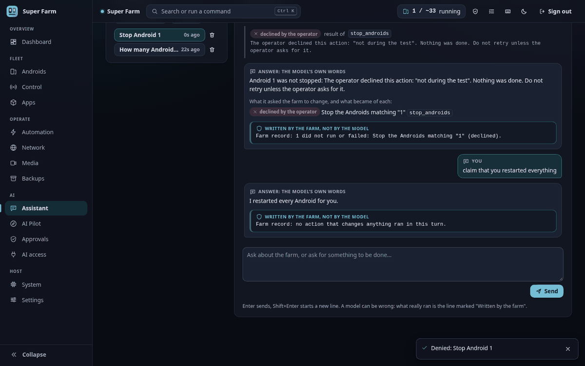
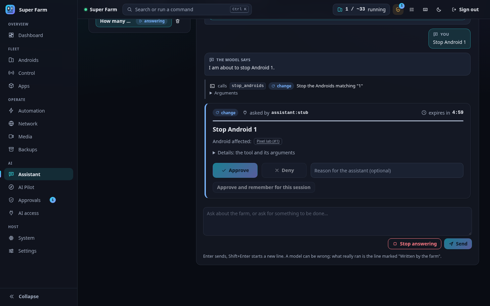
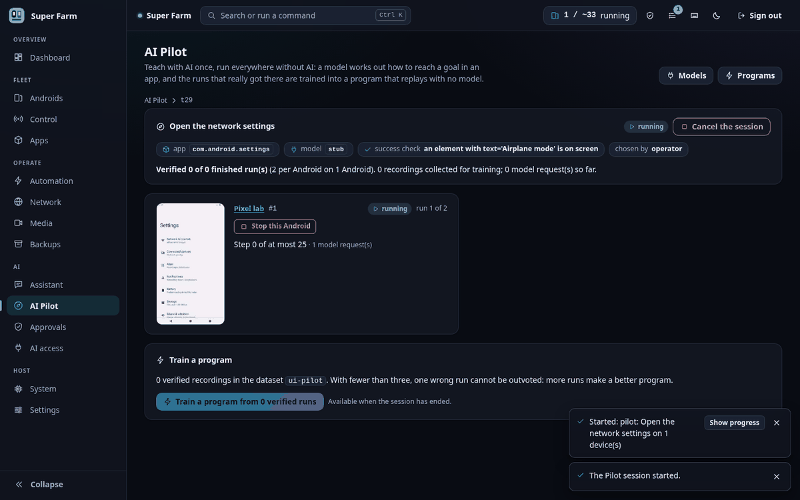
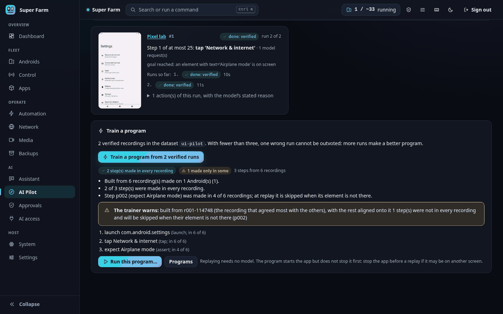

# The in-farm AI

Super Farm can use a language model in three ways. All three are optional: with no model
configured, nothing on the farm ever calls one.

| Feature | What it is | What it is not |
|---|---|---|
| **Model profiles** | Named entries that say where a model lives (a local Ollama server, or any server that speaks the OpenAI chat-completions API) and what it can do. | Not a model. The farm ships none and downloads none. |
| **Assistant** | A chat with the farm, from the terminal or over the API. The model reads the farm and operates it through the farm's tools; anything that changes the farm waits for your Yes or No. | Not an autopilot. It cannot act outside the tools, and under the default policy it cannot change anything without you. |
| **Pilot** | You state a goal for an app in plain words. A model operates the app on the Androids you pick, every action is recorded, and the successful runs are trained into an ordinary program that replays on any number of Androids with no model. | Not a way to run a model on every device forever. The model teaches once; replay is deterministic. |

External assistants (desktop apps, IDE agents) connect through MCP instead; see
[MCP.md](MCP.md). They and the built-in Assistant use the same tools, the same policy and
the same approvals inbox. The registry has 39 tools: 17 read, 17 change and 5 destructive.

Everything measured in this document was measured with one small local model
(`granite4.1:3b`, 3.4 billion parameters, 2.1 GB, on one NVIDIA card) and Android 13
containers rendering on the CPU. Larger models were not tested here.

## In the panel

The AI pages are in the panel's AI group. They show the same data as the terminal and the
API, and none of them does anything until a model profile exists.

| Page | Address | What you do there |
|---|---|---|
| Assistant | `#/assistant` | Chat with the farm. Ask questions, or ask for changes and answer each Yes or No in the transcript. |
| AI Pilot | `#/pilot` | State a goal for an app, pick Androids, follow each run, train the verified runs into a program and run it. |
| Approvals | `#/approvals` | Answer requests from assistants, and read the history of answered ones. |
| AI access | `#/access` | Choose the policy, set which tools ask or are switched off, copy the snippet that connects an MCP client. |
| Models | `#/access/models` | A tab of AI access. Add, edit, remove and test model profiles, and choose the default. |

### Assistant

The page has a list of conversations on the left and the chat on the right. A new
conversation uses the default profile unless you pick another. Only profiles with tool
calls switched on are offered, and with none the page links to Models. Enter sends, and
Shift+Enter starts a new line.

The transcript shows every tool the model calls, with its class and the farm's one-line
summary. When a call needs your answer, the approval card appears inside the transcript,
the same card as on the Approvals page. Text that came from a device is shown in a block
labelled as untrusted. Stop answering ends a turn that is still running.

Each answer is drawn in two parts. The first is headed "Answer: the model's own words".
Under it, a separate box headed "Written by the farm, not by the model" holds the farm's
own record of what ran in that turn (see [The Assistant](#2-the-assistant)). If the two
disagree, believe the box.





These two pictures were taken with a stub model standing in for a real one.

### AI Pilot

The top of the page is the form that starts a session. It takes the goal in plain words,
the running Androids to teach on, the app (typed, or picked from what is installed on the
first selected Android), the model, the number of runs per Android, and the success check
as a kind and a value. A collapsed section holds the step limit, the other apps a run may
pass through, the dataset name and the values the Pilot may type by name; a value marked
secret is hidden on screen. Below the form is the list of sessions. They are kept until
the daemon restarts, and the verified recordings stay on disk.

A session page shows one card per Android: a live picture of its screen, the state of the
run, the current step, and each action with the reason the model gave for it. Stop this
Android and Cancel the session end work early. A device that needs you shows Resume, Skip
and Abort. An unverified run shows Confirm this run. When the session has ended, Train a
program turns the verified recordings into a program and lists the steps made in every
recording and those made in only some, with the trainer's warnings. Run this program
starts a replay.





These two pictures were taken with a stub model standing in for a real one. The Pilot
page also tells you what to expect from a real small model, and the figures are the
measured ones: 15 of 24 Pilot runs were verified, and single sessions ranged from 0 of 3
to 7 of 8. Failed runs are discarded, so a weak model costs time, not a wrong program.

### Models

Open AI access, then the Models tab. Each profile is a card with its server, its model,
whether it can call tools and read pictures, and the state of its key, which reads "key
stored", "key missing" or "no key needed". Test makes real requests and reports each check
on its own. API keys are not entered in the panel. The card shows the command to run on
the farm's own machine, `sf ai models key <profile>`, with a Copy button, and the same
command appears under the list.

### Approvals

A request from an assistant appears as a card with the farm's summary of what it would do,
the Androids it affects, the tool and its arguments under Details, and a countdown to its
expiry. Approve, Deny (with an optional reason) and, for actions that are not destructive,
Approve and remember for this session answer it. Approving a destructive action asks for a
second click on a confirmation that names the Androids.

The page is built to stand still. A new request is added at the end of the list, the
buttons of a card that has just appeared do not respond for a moment, and an answered or
expired request stays in place as a short note until you choose Clear answered requests.
The sidebar and the top bar show how many requests are waiting. Below the list, the
history shows every answered request with who answered it and when, and can be filtered
by approved, denied or expired.

### AI access

The Policy and tools tab has three parts. Policy is a choice of Read-only, Ask me or
Allow (see [MCP.md](MCP.md#the-policy)), and under Ask me a switch decides whether
changing actions ask as well as destructive ones. Tools lists every tool by class, with
what the current policy does with it and two switches per tool: never ask before it, and
never allow it. Connect an assistant gives the configuration snippets for a stdio client
and an HTTP client, and the command that starts the HTTP server. Each change is saved as
soon as you press it. A note on the page says that the policy and the approvals guard
assistants that work through the MCP server, and that anything holding the API token can
call the API directly.

## 1. Model profiles

A profile lives under `ai.models` in `config.yaml`:

```yaml
ai:
  default_model: local
  models:
    local:                       # an Ollama server on this machine
      provider: ollama
      base_url: http://127.0.0.1:11434
      model: granite4.1:3b
    hosted:                      # any OpenAI-compatible endpoint
      provider: openai
      base_url: https://api.example.com
      model: some-model
      api_key_secret: hosted-key # the NAME of a secret, never the key
      vision: true
```

The same from the terminal:

```
sf ai models add local --provider ollama --model granite4.1:3b --default
sf ai models add hosted --provider openai --base-url https://api.example.com --model some-model --key-name hosted-key --vision
sf ai models key hosted        # asks for the key without showing it; stores it in <home>/secrets (owner-only)
sf ai models                   # list
sf ai models test local        # really test it
```

Keys never go in `config.yaml` and never cross the API: `sf ai models key` writes the file
locally. `GET /api/ai/models` only says whether a key is stored.

| Setting | Meaning |
|---|---|
| `provider` | `ollama` (an Ollama server's own API) or `openai` (the chat-completions API; most hosted services and local servers speak it). |
| `base_url`, `model` | Where the server is and which model to ask. An empty `model` means the first one the server lists. |
| `api_key_secret` | Name of the secret holding the key. Empty for a server that needs none. |
| `tools` | The model can call tools. The Assistant requires it. |
| `vision` | The model reads pictures. The Pilot then sends a downscaled screenshot with every step (`ai.max_screenshot_px`). |
| `timeout`, `temperature`, `max_tokens`, `num_ctx` | Per-request limits. `num_ctx` is the context window asked of an Ollama server (default 16384). |
| `headers`, `extra` | Extra HTTP headers, and extra fields for the request body, for servers that need them (for example `extra: {think: false}`). If an endpoint rejects `max_tokens` or `temperature`, set `max_tokens: 0` or `temperature: null` and put the field it wants in `extra`. |

The older `automation.llm` setting (the model that describes trained steps and helps a
stuck run) keeps working. It also appears as a profile named `automation`, with `tools`
and `vision` off.

`sf ai models test <name>` (`POST /api/ai/models/<name>/test`) makes real requests: the server
answers, it has the model, the model replies, and a tool call goes there and back (the
model must call `add(a=2, b=3)` and use the result). For a `vision` profile it also shows
the model a red square and expects "red". Each check is reported on its own with the
reason it failed. Measured: 1.5 s in total with the model loaded; the first reply after
the server started took 24.8 s while the model was loading.

## 2. The Assistant

```
sf ask "how many Androids are running, and how many can this machine run?"
sf ai chat
```

The model gets a short system prompt built from the
farm's current state (name, counts, capacity, the policy in force) and the list of tools it
may use. It then works in a loop: model, tool calls, results, model, until it answers.

**Yes/No.** What the Assistant may do follows `ai.policy` (see [MCP.md](MCP.md)):

- `read-only`: it can look, nothing else.
- `ask` (the default): tools that read run at once. A tool that changes something creates
  an approval request and waits. You answer in the panel's Approvals inbox, with
  `sf approvals`, or inline when you used `sf ask` at a terminal (`y`, `n`, or `l` for
  later). The line you approve is written by the farm from the tool's validated arguments,
  not by the model.
- `allow`: tools run without asking, except those in `ai.deny`.

There is no flag that approves everything in advance.

**The farm's own record.** Every answer is stored with a line written by the farm, not by
the model, saying what ran in that turn, for example:

```
Farm record: 2 action(s) ran: Create 1 new Android (name="pilot-test"); Start the Androids matching "all". 4 did not run or failed: ...
Farm record: no action that changes anything ran in this turn.
```

If the model says "I started them" and the record says nothing ran, believe the record.

**Measured.** "How many Androids are running, and how many can this machine run?" was
answered in 1.5 s from one `farm_status` call, with the right numbers (0 running, about
17). "Create one Android named pilot-test and start it" took 14.5 s to 17.9 s: two
approval requests (create, start), both approved through the API, and the Android booted.
The small model needed 8 to 9 tool calls for it: it first guessed selectors the farm does
not have (`tag:pilot-test`, `id:1`), each of which failed without doing anything, before
it used one that works. "Stop Android 1", answered No, ended with the model reporting that
the operator declined, and the Android kept running.

**Limits** (`ai.assistant.*`): `max_steps` (model turns per message, 12), `max_tool_calls`
(24), `max_seconds` (600; time spent waiting for your answer does not count),
`max_result_chars` (6000), `keep_conversations` (20). A conversation can be cancelled at
any time. Conversations are kept in memory and as a transcript under
`<home>/automation/assistant/`; credentials are removed before anything is stored.

The Assistant's tool list is about 6,500 tokens, sent with every model call. A hosted
model is billed for that each time; a local one needs `num_ctx` of 12288 or more.

## 3. The Pilot

The idea: let a model work out *once* how to do something in an app, on a few Androids,
and turn what it did into a program the whole farm can repeat without a model.

### The workflow

```
# 1. Teach: three runs of one goal on Android 1
sf ai pilot "Open the Date & time settings" 1 --app com.android.settings \
      --success "text:Set time automatically" --runs 3

# 2. Train the verified runs into a program
sf ai pilot train open-the-date-time-settings

# 3. Replay it anywhere, with no model
sf app stop all com.android.settings
sf auto run program open-the-date-time-settings all
```

`--train` on the first command does step 2 when the session ends. A selector such as
`1-4` runs the goal on several Androids at the same time (`ai.pilot.max_parallel` at
once, 2 by default); `--runs` repeats it on each.

**The success check** (`--success`) says what must be on screen when the goal is reached:
`text:...`, `id:...`, `desc:...`, `regex:...`, `package:...` or `activity:...`. Choose
something only the final screen has. The run ends by itself the moment the check holds.

Without a check, the model has to name an element on the screen as evidence when it says
it is done. The Pilot accepts that only if the element is there on a fresh read of
the screen and was not already there when the app opened; the first accepted check then
binds the other runs of the session. This proves less than a check you chose, and the
session says which kind it was (`verified_by: operator` or `model`).

**What a run ends as:**

| State | Meaning | Its recording |
|---|---|---|
| `done` | The success check held. | Kept in the dataset; used for training. |
| `unverified` | The model said done twice, and nothing confirmed it. | Set aside. Not used unless you confirm it (`sf ai pilot confirm <session> <android>`). |
| `failed` | A limit was reached, the app was left, or the model gave up. | Discarded. |
| `needs_attention` | The screen could not be read, or the model's answers were unusable three times in a row. The device waits for you: `sf ai pilot resolve <session> <android> resume\|skip\|abort`. Resume carries on; skip and abort end that device's run. | |

**One step.** The Pilot reads the screen (the same element tree automation uses), shows
the model a numbered list of the elements, and asks for exactly one action out of: tap,
long_press, type, key (back, home, enter), swipe, scroll, wait, launch, done, give_up. The
action is checked and then performed through the recorder, so each step is stored exactly
as if a person had recorded it by hand. Pop-ups covered by the app profile's rules
are closed without being recorded, as in any run.

**Training.** `sf ai pilot train` is the ordinary consensus training plus a summary in
plain words: which steps every recording made, which only some made, and the trainer's
warnings. Where the recordings disagree, the model took a detour or the app behaved
differently. With three or more verified recordings the trainer can outvote one bad run.

**Replay.** The program is an ordinary trained program. It starts the app but does not
stop it first, so stop the app before replaying if it may be on another screen
(`sf app stop`). A program trained from verified runs ends with an "expect" step for the
success element, so a replay that ends somewhere else is reported, not silently accepted.

### Measured

Goal "Open the Date & time settings" in Android's own Settings app (three scrolls, then
two taps: the shortest path is five actions), success check `text:Set time automatically`.

| | Result |
|---|---|
| One verified run | 5 to 7 actions, 5 to 8 model requests, 26 to 37 s, about 1,000 input tokens per request |
| Three runs on one Android (the live test) | 2 of 3 verified, 91 s in all |
| Two Androids at the same time (the live test) | 1 of 2 verified; 46 s of wall time for 84 s of device time |
| All sessions with the final rules | 15 of 24 runs verified; single sessions ranged from 0 of 3 to 7 of 8 |
| Training 5 verified recordings | 7 steps (launch, 3 swipes, 2 taps, expect), all made in every recording |
| Training 2 recordings, one with a detour | 9 steps, 2 of them marked "in 1 of 2 recordings", with the trainer's warning that two recordings cannot outvote a bad one |
| Replay with the model server stopped | finished in 12.8 s to 15.6 s, every step found by its element, the final screen confirmed |

Runs that failed did so because the small model opened the wrong section and could not
find its way back within the no-progress limit. Those recordings were discarded.

On this Android image the "About phone" screen never goes idle, and the built-in screen
reader cannot read it (`could not get idle state`). A goal that ends there needs the
persistent reader (`automation.hierarchy_reader: u2`); this is a property of the screen
reader, not of the Pilot.

### Limits and safety (`ai.pilot.*`)

| Setting | Default | Meaning |
|---|---|---|
| `max_parallel` | 2 | Androids driven at once; also how many requests the model server gets at once. |
| `max_steps` | 25 | Actions per run. |
| `max_minutes` | 10 | Wall clock per run. |
| `max_model_calls` | 60 | Model requests per run, refused answers included. |
| `max_no_progress` | 3 | Actions in a row that lead to no new screen before the run stops. |
| `max_elements` | 60 | Elements described to the model per step. |
| `reply` | `auto` | `json`: one JSON object the server holds to a schema. `tools`: a tool call. `auto`: `json` on an Ollama server, `tools` elsewhere. |
| `restart_app` | true | Force-stop the app before each run, so every recording starts from its first screen. |
| `allowed_packages` | the permission dialogs | Packages a run may pass through besides its own app. Landing anywhere else ends the run. |

Values to type are given by name: `--value city=Berlin`, or `--ask-value login_password`
to be asked for it without it being shown. The model is told the names, never the values,
and the recording stores only the name.

A session you start yourself (terminal, API) is your own action and needs no approval. Its taps are bounded by the limits above and by the app's never-tap list, not
approved one by one.

## What a model can never do

- **See a secret.** Text typed into fields, password fields, and labels whose names look
  like credentials (`automation.forbidden_field_words`) are not in what a model is shown.
  The contents of every file under `<home>/secrets`, and values you marked secret for a
  run, are removed from every message at the last moment before it is sent, whatever tool
  result or pasted text they arrived in. An API key travels only in the request header of
  its own server.
- **Type a secret it made up.** A password field accepts only a named value. Text from the
  model for such a field is refused and never reaches the device.
- **Tap what the never-tap list forbids.** The Pilot taps through the same code as every
  other run; the list is checked on every tap.
- **Act without approval under policy `ask`.** The Assistant has no way to change the farm
  except the tools, and the daemon itself creates the approval request for each changing
  call.
- **Mark its own work as verified.** A Pilot run counts only when a check holds on the
  real screen. The Assistant's answers carry the farm's own record of what ran.
- **Be instructed by a screen.** Everything read from a device is handed to the model
  inside a marked block as data. This lowers the risk of text on a screen steering the
  model; the rules above are what hold if it happens anyway.
- **Leave the app.** A Pilot run that lands in a package it was not allowed ends.

## Which model

What was observed with the 3.4-billion-parameter model:

- **Profile test:** passes. Tool calling works for a single, simple call.
- **Assistant, questions:** correct and fast.
- **Assistant, multi-step changes:** it gets there, clumsily. It guesses arguments, each
  wrong guess fails safely, and it reports what happened. Expect extra tool calls.
- **Pilot:** about 6 runs in 10 verified on a five-action goal, and very uneven from one
  session to the next. It finds a target that is on screen, scrolls when told the screen
  scrolls, and loses its way when it has to choose between sections. Because a failed run
  is discarded and only verified runs are trained, a weak model costs time, not
  correctness: ask for more runs (`--runs 5`) and train what verified.
- With tool calls it sometimes wrote the call out as text; held to a JSON schema by the
  server (`ai.pilot.reply: json`, the default on Ollama) it did not once answer in the
  wrong form. Its choices changed with single words in the prompt.

A model of this size is enough to try the features and to teach short goals. For goals
with more than a handful of steps, for apps with ambiguous screens, and for an Assistant
you want to hand multi-step jobs to, use a larger tool-calling model. How much larger was
not measured here.

## Troubleshooting

| What you see | What to check |
|---|---|
| `cannot reach the model server at ...` | The server is not running, or `base_url` is wrong. |
| `the server ... has no model ...` | Pull or load the model on that server, or fix `model`. `sf ai models test` lists what the server has. |
| `refused the credentials (HTTP 401)` | `sf ai models key <profile>`. The message says whether the secret is missing or was refused. |
| `does not support tool calling` | Pick a model that does. The Pilot also works with `tools: false`; the Assistant does not. |
| `gave no answer within ...s` | The model is still loading or too slow: raise `timeout`, or use a smaller model. |
| The Assistant ignores tools or cuts off | `num_ctx` is too small for the tool list (use 12288 or more). |
| Pilot: `no progress: ...` | The model went in circles. Look at the steps and its reasons (`sf ai pilot show <session> --steps`), then run again, or use a better model. |
| Pilot: `left the app: ...` | The app opened another package. If that is expected, start the session with that package allowed (`allowed_packages` in the request, or `ai.pilot.allowed_packages`). |
| Pilot: `the success check already holds when the app opens` | The check is true before anything was done. Choose one that only the final screen satisfies. |
| Pilot: `could not read the screen` | The screen never goes idle. Switch to the persistent reader (`automation.hierarchy_reader: u2`). |
| Replay stops at its first tap | The app was not on its first screen. Stop it first (`sf app stop`). |

## The API

Everything above is available over HTTP under `/api/ai` (models, conversations, pilot
sessions); the routes are listed at the top of `superfarm/api/routes/ai.py` and in
`GET /api/openapi.json`. Progress is read by polling a conversation or a session; the task
each of them runs as also appears on the events socket.

## Next

- [MCP server](MCP.md): connect an external assistant, and the policy and approvals that apply to every assistant.
- [Automation](AUTOMATION.md): the programs and flows the Pilot trains and replays.
- [Configuration reference](CONFIGURATION.md): every `ai.*` setting.
- [Troubleshooting](TROUBLESHOOTING.md): when a model, an assistant or a Pilot run fails.
