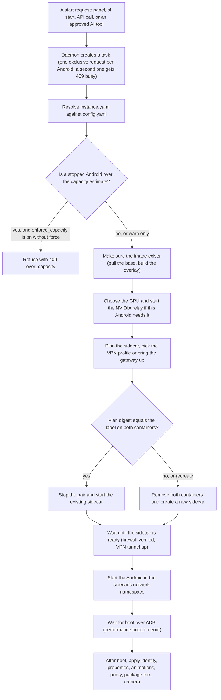

# Architecture

For people who want to know how Super Farm is put together before they change it, debug it or trust it.

This page names the pieces, follows one start of an Android from the request to the booted device, and says where every kind of state lives. The reasons behind the design are in [DESIGN_NOTES.md](DESIGN_NOTES.md).

## The pieces

| Piece | What it is | Runs as |
| --- | --- | --- |
| Daemon | One Python process (`sf serve`): the HTTP API, the WebSockets, the static panel, and a ticker that calls `Farm.tick()` every 30 seconds for schedules, scheduled backups and camera upkeep | your desktop user |
| `sf` command line | Local commands (`doctor`, `host`, `config`, `token`, `serve`, `service`, `version`, `completion`) call the modules directly. Every other command is an HTTP client of the daemon. | your user |
| Panel | Static files in `superfarm/web` (plain ES modules, no build step, no external requests), served by the daemon from `/` | the browser |
| MCP server | `sf mcp`: serves the tool registry to MCP clients. It is a client of the daemon's API, like `sf`. | your user, started by the MCP client |
| Host setup | `sf host apply`: packages, kernel modules, kernel limits, groups, runtime folders, a boot unit. The only part that needs root. | root, once and at every boot |
| Docker | Runs two containers and one volume per Android, plus one container and one network per shared VPN gateway | the Docker daemon |
| NVIDIA relay | One patched `virgl_test_server --venus` process per NVIDIA card, started by the daemon when the first NVIDIA Android starts | your user |

The daemon manages Androids and does not keep them alive. Stopping the daemon (Ctrl-C, SIGTERM, `sf service stop`) closes what the daemon itself started on the host, such as scrcpy windows and camera feeders. The Androids are Docker containers and keep running.

Inside the daemon, `superfarm/farm.py` is the composition root: one `Farm` object creates every component on first use and hands each to the others. A component that cannot be built (an optional tool is missing) reports itself as unavailable with the reason, and the rest keeps working.

## The container pair

One Android is two containers and a volume. The prefix comes from `docker.name_prefix` (default `sf`).

| Object | Name for Android N | Role |
| --- | --- | --- |
| Sidecar container | `sf-net-N` | Owns the network namespace: firewall, VPN client, route sync, and the published ADB port `<network.adb_bind>:<network.adb_port_base + N>` |
| Android container | `sf-android-N` | The Android itself, started with `--privileged` and `--network container:sf-net-N` |
| Data volume | `sf-data-N` | Mounted at `/data`; survives every rebuild of the containers |

Every object carries the labels `io.superfarm.farm=<prefix>`, `io.superfarm.instance=<N>` and `io.superfarm.role=<role>`. The farm finds its own objects by label and never removes a container that lacks them.

Two rules govern the pair:

- The two containers are created and removed together, sidecar first. Android's network service rewrites the routing of the namespace it joins, so an Android recreated alone next to a running tunnel would drop that tunnel.
- Containers are rebuilt only when their plan changed. The planner turns the resolved settings into `docker run` arguments, and a digest of those arguments is stored on both containers as the label `io.superfarm.plan`. A start compares the digest and reuses the containers when it matches.

## How a start works



The same steps as a list:

1. A request arrives: `POST /api/instances/{id}/start` or `POST /api/instances/bulk`. The panel, `sf start`, a script and an approved AI tool all end here.
2. The daemon submits a task and answers `202` with the task. Lifecycle work is exclusive per Android: while a task holds an Android, a second request for it is refused with `409 busy` and the id of that task.
3. The instance spec (`instances/<id>/instance.yaml`) is resolved against `config.yaml`. Every value the spec leaves out follows the farm default.
4. If the Android is already running and this is a plain start, nothing is rebuilt. The start waits for boot, applies the post-boot settings and ends.
5. For a stopped Android the capacity estimate is asked. Over the estimate, the start warns and continues, or is refused when `performance.enforce_capacity` is on and the request carries no `force`.
6. The Android version about to boot is compared with the one that last booted this data volume. A downgrade is refused unless forced.
7. The image is made ready: an exact image if the spec names one, otherwise `superfarm/android:<version>`, built from the upstream base plus the files under `<home>/overlays/android/<version>/`.
8. CPU pinning and the GPU are chosen. For an NVIDIA choice the relay is started if it is not running.
9. The sidecar's arguments are planned. This builds the sidecar image when it is missing, picks and sanitises the VPN profile in `vpn` mode, and brings the shared gateway up in `gateway` mode.
10. Every refusal happens before this point. A refused restart leaves a running Android as it was.
11. The plan digest is compared with the label on the existing containers. If it matches, the pair is stopped and the same containers are started again, sidecar first. Otherwise both are removed and created anew.
12. If the renderer differs from the one this data last ran with, the apps' compiled shader caches are deleted from the volume first.
13. The sidecar starts: firewall, then DNS for the VPN server names, then the tunnel, then the route sync loop. The farm waits until the sidecar reports ready and its live firewall rules have been verified.
14. The Android container starts in the sidecar's network namespace.
15. The farm connects over ADB and waits for `sys.boot_completed`, up to `performance.boot_timeout` seconds.
16. Post-boot settings are applied: `android_id`, locale, time zone and mock location, extra properties, animation scales, the HTTP proxy in `proxy` mode, the one-time package trim, and the camera hook. Each is independent, and one that fails becomes a warning on the start result.

Stopping is the reverse: the Android container first, then the sidecar.

## Networking topologies

`network.mode` sets the farm default and each Android can override it.

| Mode | Path of an Android's traffic | Kill switch |
| --- | --- | --- |
| `direct` | Sidecar on a Docker bridge, NAT through the host. Private, link-local and carrier-grade NAT destinations are blocked unless `network.allow_lan` is on. | not applicable |
| `vpn` | An OpenVPN or WireGuard client inside the sidecar. Everything leaves through the tunnel. | yes |
| `gateway` | The sidecar joins the network of a shared gateway and routes through it. | yes |
| `proxy` | As `direct`; Android's global HTTP proxy is set after boot. | no |
| `none` | No outbound traffic at all. ADB is still published. | all outbound dropped |

A shared gateway named `G` is three objects:

```
sf-gw-G        the sidecar image running as a gateway server: one VPN client plus NAT; forwards members into the tunnel only
sf-gwnet-G     a bridge network with no NAT and no address on the host; a private /24 from docker.subnet_pool
sf-bridge      the farm's uplink network: carries the gateways' VPN transport and the members' published ADB ports
```

A member's sidecar sits on both networks. Its firewall lets only ADB answers out on the uplink and everything out on the gateway network, where the gateway container is the only router. One gateway holds at most 126 Androids.

Inside every sidecar a route sync loop runs every 2 seconds. Android's network daemon routes through its own per-interface table and removes routes it did not create, so the loop keeps the tunnel's routes in that table. [NETWORKING.md](NETWORKING.md) describes the modes from the operator's side, and [SECURITY_MODEL.md](SECURITY_MODEL.md#the-kill-switch) states what the kill switch guarantees.

## The NVIDIA relay path

Android's graphics stack is Mesa. Mesa drives Intel and AMD cards directly: the Android container gets the render node as a device and uses redroid's `host` GPU mode. Mesa has no driver for NVIDIA's proprietary stack, so an NVIDIA Android draws through a relay:

```
inside the Android
  GLES  -> ANGLE -> Vulkan
  Vulkan -> Mesa Venus driver (vulkan.virtio.so)
         -> Unix socket /venus/vtest.sock            bind-mounted from the host
on the host
  virgl_test_server --venus (patched) -> NVIDIA Vulkan driver -> the card
```

- One relay process runs per NVIDIA card, as your user. Its socket is `<gpu.nvidia.socket_dir>/<node>/vtest.sock`, and the folder is mounted into the Android at `/venus`.
- Four runtime files are bind-mounted read-only into each NVIDIA Android: the Venus driver, a 64-bit and a 32-bit allocator (`gralloc.venus.so`) and a `gpu_config.sh` with a `venus` mode. The Android image itself is not modified.
- The relay must run before an NVIDIA Android starts, and a running relay is never restarted, because every NVIDIA Android holds connections to it. The daemon's systemd unit uses `KillMode=process` so that a daemon restart leaves the relay alone.
- The runtime and the relay are built from `native/venus/` into `<home>/overlays/venus/` and `<home>/overlays/venus-relay/`. They are built for Android 13 only.

[GPU.md](GPU.md) covers choosing a mode and building the runtime.

## Where state lives

Everything the farm owns is under one home folder: `$SUPERFARM_HOME`, by default `~/.local/share/superfarm`. A second home is a second, separate farm (give it another `docker.name_prefix`).

| Path under the home | Holds |
| --- | --- |
| `config.yaml` | Only the settings that differ from the defaults |
| `secrets/` | API token, VPN credentials, model keys, the farm backup seal key (folder 0700, files 0600) |
| `instances/<id>/instance.yaml` | What you asked for: one Android's spec, including its device identity |
| `instances/<id>/state.json` | What the farm decided or saw: chosen VPN profile, last renderer, trim marker, last error |
| `apps/` | The app library |
| `vpn/` | Imported VPN profiles |
| `gateways/<name>/` | The sanitised profile copy a gateway runs with |
| `media/` | Video and audio files usable as camera and microphone sources |
| `automation/` | Datasets and recordings, trained programs, flows, app profiles, values and pools, fix memory, schedules, Assistant transcripts |
| `overlays/android/<version>/` | Files layered onto the Android image of that version |
| `overlays/venus/`, `overlays/venus-relay/`, `overlays/camera/<version>/` | The NVIDIA runtime, the relay, the camera HAL overlay |
| `backups/` | `android-<id>/<UTC time>/` and `farm/<UTC time>/` (or the folder named by `backup.dir`) |
| `logs/` | `daemon.log`, `audit.log`, `audit-anonymous.log`, `approvals.jsonl`, relay logs |
| `run/` | Sockets, FIFOs, uploads in progress; recreated at start |

Outside the home:

| Where | What |
| --- | --- |
| Docker | The containers, the `sf-data-N` volumes (all Android data), the images `superfarm/android:<version>`, `superfarm/net:<hash>` and `superfarm/tools:1`, and the gateway networks |
| `/etc/modules-load.d/superfarm.conf`, `/etc/modprobe.d/superfarm.conf` | Kernel modules to load at boot, written by `sf host apply` |
| `/etc/sysctl.d/90-superfarm.conf` | Kernel limits |
| `/etc/tmpfiles.d/superfarm.conf`, `/run/superfarm/` | Runtime folders, including the relay sockets |
| `/etc/systemd/system/superfarm-host.service` | The boot unit that reloads modules and recreates devices |
| `~/.config/systemd/user/superfarm.service` | The daemon as a user service, written by `sf service install` |

Held in memory only, and lost when the daemon restarts: browser sessions, task history, the run status of automations, pending approval requests (they are expired at start) and "approve and remember" grants.

## Requests, tasks and events

- Every route is under `/api` and returns JSON. Errors have one shape: `{"error": {"code", "message", "detail"}}`.
- Work that touches several Androids or takes more than a moment runs as a task. The route answers `202` with the task, and `GET /api/tasks/{id}` or `sf tasks <id>` follows it. Each device has its own outcome, and one that fails or stalls does not hold up the others.
- `WS /api/events` pushes task and instance changes to the panel. It is a convenience: everything it reports can also be read by polling.
- `POST /api/instances` accepts an `Idempotency-Key` header, so a repeated create returns the first answer.

[API.md](API.md) is the route reference.

## The tool registry

`superfarm/ai/tools.py` holds one registry of 39 tools (17 read, 17 change, 5 destructive): name, description, JSON Schema for the arguments, class (`read`, `change` or `destructive`), a function that writes the one-line summary an operator approves, and the call itself. Each tool is a thin wrapper over API routes, so authentication, validation, capacity rules and the audit log apply to a model as they do to anyone else.

Two consumers use the registry, and both go through the same function, `invoke()`:

- `superfarm/mcp/server.py` serves it to external MCP clients over stdio or loopback HTTP. It is the only module that imports the MCP SDK.
- `superfarm/ai/assistant.py` is the built-in Assistant. It calls `invoke()` directly, over the same API.

For a tool that changes the farm, `invoke()` asks the daemon (`POST /api/approvals`). The daemon applies `ai.policy`, writes the summary and, under `ask`, queues a request that waits for the operator's Yes or No. [MCP.md](MCP.md) and [AI.md](AI.md) describe this from the operator's side.

## Module map

All paths are under `superfarm/`.

### Foundation

| Module | Purpose |
| --- | --- |
| `config.py` | Every setting, with its default, limits and description; load, save and patch |
| `paths.py` | The layout of the farm home |
| `resources.py` | Finds `deploy/`, `scripts/` and `native/` in a checkout or an installed wheel |
| `farm.py` | The composition root: builds and wires every component |
| `util/proc.py` | Runs other programs as argument lists, never through a shell |
| `util/files.py` | Atomic writes, owner-only secrets, safe file names, path confinement, file locks |

### core

| Module | Purpose |
| --- | --- |
| `core/models.py` | `InstanceSpec`, `Resolved`, container names, selectors, id checks |
| `core/store.py` | Reads and writes `instance.yaml` and `state.json` |
| `core/planner.py` | Pure function from resolved values to `docker run` arguments; the plan digest; CPU pinning |
| `core/instances.py` | The life of an Android: create, start, stop, rebuild, clone, delete; capacity checks |
| `core/images.py` | Android images per version (base plus overlay) and the helper image |
| `core/docker.py` | A thin layer over the Docker command line |
| `core/adb.py` | One Android over ADB, every call bounded by a timeout |
| `core/tasks.py` | Background tasks with per-device results; the one-request-per-Android rule |
| `core/backup.py` | Android and farm backups, verify, restore, prune, the safety backup |
| `core/device_profile.py` | Device presets and how an identity is applied at boot and after boot |
| `core/metrics.py` | Host, GPU and per-Android load; CPU topology |

### host

| Module | Purpose |
| --- | --- |
| `host/doctor.py` | The 46 checks behind `sf doctor`, each with its fix |
| `host/setup.py` | Plans and applies host setup; the only code that runs as root |
| `host/distro.py` | Detects the distribution family and names its packages |
| `host/modules.py` | The kernel modules the farm needs and how to tell they are loaded |
| `host/gpu.py` | Detects GPUs from sysfs and chooses how one Android draws |
| `host/venus.py` | Starts and finds the NVIDIA relay; the mounts an NVIDIA Android needs |
| `host/capacity.py` | The capacity estimate from measured per-Android figures |
| `host/service.py` | The daemon as a systemd user service |

### net

| Module | Purpose |
| --- | --- |
| `net/sidecar.py` | The sidecar image and its `docker run` arguments |
| `net/vpn.py` | VPN profiles (import, sanitise, select) and credentials |
| `net/gateway.py` | Shared VPN gateways and their networks |
| `net/killswitch.py` | Firewall settings for a sidecar and verification of the live rules |
| `net/status.py` | Reads a sidecar's state and interprets the VPN client's log |

The scripts that run inside the sidecar are in `deploy/docker/net/`: `entrypoint.sh`, `killswitch.sh`, `routesync.sh` and `healthcheck.sh`.

### control, stream and media

| Module | Purpose |
| --- | --- |
| `control/library.py`, `control/apkinfo.py` | The app library; reads APK metadata without Android build tools |
| `control/apps.py`, `control/permissions.py` | Install, ensure, uninstall, launch, stop, clear, grant and revoke across a selection; the version matrix |
| `control/files.py` | Push, pull, list, and add to the gallery |
| `control/device.py` | Locale, time zone, location, clipboard, screenshots, logcat, reboot |
| `control/shell.py` | Shell commands on Androids with time and output limits; the denylist |
| `stream/screen.py` | Screenshots shared between viewers; a device nobody watches costs nothing |
| `stream/h264.py` | The experimental H.264 live view, relayed from scrcpy-server |
| `stream/input.py` | Taps, swipes, keys and text for one device or many |
| `stream/scrcpy.py` | Native scrcpy windows on the daemon's desktop |
| `media/camera.py`, `media/feeds.py` | The virtual camera and microphone: devices, ffmpeg feeds, forwarders |
| `media/audio.py` | Listening to one Android on the host's speakers |

### automation

| Module | Purpose |
| --- | --- |
| `automation/ui.py` | Reads the screen as a tree of elements, bounded and never stale |
| `automation/selectors.py` | Finds an element: scoring for trained programs, exact selectors for flows |
| `automation/recorder.py` | Recording sessions: resolve the element first, then send the tap |
| `automation/align.py`, `automation/trainer.py`, `automation/program.py` | Align recordings, build a program by consensus, the program format |
| `automation/runtime.py`, `automation/runner.py` | One device's run and its rules; one run across the fleet |
| `automation/flows.py` | Hand-written YAML flows |
| `automation/profiles.py` | Per-app roles, pop-up rules and the never-tap list |
| `automation/values.py` | Shared values, per-Android values and consumable pools |
| `automation/memory.py`, `automation/llm.py` | Remembered recoveries; the optional model that annotates and recovers |
| `automation/schedule.py`, `automation/store.py`, `automation/plainyaml.py` | Recurring runs, the on-disk layout, YAML loading without aliases |

### ai and mcp

| Module | Purpose |
| --- | --- |
| `ai/tools.py`, `ai/schema.py` | The tool registry, `invoke()`, argument checks |
| `ai/policy.py`, `ai/approvals.py` | The policy decision and the approvals queue |
| `ai/safety.py`, `ai/outbound.py` | Redaction, device content marking, the last check before anything is sent to a model |
| `ai/models.py` | Model profiles and the one place a model is called from |
| `ai/assistant.py` | The built-in Assistant |
| `ai/pilot.py`, `ai/pilot_tools.py` | The Pilot, and the Pilot as tools |
| `mcp/server.py`, `mcp/prompts.py`, `mcp/clientconfig.py` | The MCP server, its prompts, the client configuration snippet |

### api, cli and web

| Module | Purpose |
| --- | --- |
| `api/app.py` | Builds the application: Host and body checks, security headers, CORS, audit |
| `api/auth.py` | Token, sessions, CSRF, rate limit, Host and Origin checks |
| `api/audit.py` | The audit logs |
| `api/errors.py`, `api/common.py`, `api/uploads.py` | The error shape, shared request models, streamed uploads |
| `api/ws.py` | The events socket and the H.264 socket |
| `api/server.py` | The daemon process: uvicorn, the ticker, clean shutdown |
| `api/routes/*.py` | One module per area: system, instances, net, control, stream, media, automation, backups, approvals, ai |
| `cli/main.py`, `cli/local.py`, `cli/commands/*.py` | The parser, the local commands, the client commands |
| `cli/client.py`, `cli/common.py`, `cli/render.py`, `cli/values.py` | The HTTP client, task following, tables, typed `key=value` |
| `cli/configdocs.py`, `cli/completion.py` | Generates the settings reference and the shell completion |
| `web/` | The panel: `index.html`, `css/`, `js/` with one module per page |

Outside the package: `deploy/` (Dockerfiles and systemd unit templates), `scripts/` (camera helpers, the module signing script, the quality gate), `native/` (sources and patches for the NVIDIA runtime, the camera overlay and the camera kernel module) and `tests/` (unit, live and distribution tests).

## Next

- [DESIGN_NOTES.md](DESIGN_NOTES.md): why it is built this way
- [SECURITY_MODEL.md](SECURITY_MODEL.md): trust boundaries and listeners
- [CONFIGURATION.md](CONFIGURATION.md): every setting
- [API.md](API.md) and [CLI.md](CLI.md): the references
- [DEVELOPMENT.md](DEVELOPMENT.md): working on the code
- [../AGENTS.md](../AGENTS.md): the runbook for maintainers and AI assistants
